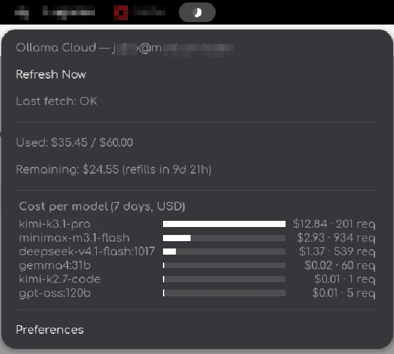

# Ollama Cloud Indicator

A GNOME Shell extension that displays [Ollama Cloud](https://ollama.com) usage in the top panel. Supports multiple accounts, [monthly credit plans](https://ollama.com/blog/transparent-pricing), and legacy subscriptions on GNOME Shell 47–50.

## Usage display

For **monthly credit plans**, the circle shows the fraction of included credits consumed. The popup shows used and remaining included credits, the refill countdown, and the separately purchased balance when there is one. These plans have no session ring or clock hand.



The model chart lists the seven-day cost per model in USD and the number of requests, both taken from Ollama's own usage JSON. Models are ranked by cost.

For **legacy subscriptions**, the outer ring shows session usage, the inner circle shows weekly usage, and the clock hand shows progress through the five-hour session. The popup includes percentages and reset countdowns.

## Installation

From source, with GNU Make, GLib development tools and gettext installed:

```bash
make install
```

This installs runtime files, compiled schemas and translations under `${XDG_DATA_HOME:-$HOME/.local/share}/gnome-shell/extensions/ollama-usage@lanesun.anlbrain.com/`.

Alternatively, build and install a ZIP:

```bash
./package.sh
gnome-extensions install --force ollama-usage.zip
```

Log out and back in on Wayland, then enable the extension:

```bash
gnome-extensions enable ollama-usage@lanesun.anlbrain.com
```

The same `ollama-usage.zip` can be uploaded to GNOME Extensions. Packaging rebuilds translations and includes all runtime modules and the stylesheet; it excludes credentials, tests, repository metadata and compiled schemas. GNOME compiles the schema during installation.

## Accounts and API keys

1. Create an API key at [ollama.com/settings/keys](https://ollama.com/settings/keys).
2. Open **Preferences** from the indicator menu, or run:

   ```bash
   gnome-extensions prefs ollama-usage@lanesun.anlbrain.com
   ```

3. Paste the key into the primary account's **ollama.com API key** field and click its apply button. Fetching starts immediately. Applying an empty value removes the key.

Alternatively, store it from a terminal:

```bash
nix shell nixpkgs#libsecret -c secret-tool store --label='ollama.com API key' account primary
```

The key lives in the system keyring (libsecret), never in GSettings. To display another account, click **Add Account**, give it a name, and apply its own key. Each account has an independent meter, refresh action, cache and error status. Additional accounts can be removed with the trash button.

## Appearance and refresh

Preferences provide ring, circle and hand colors and dimensions, panel position and index, and a refresh interval from 5 to 3,600 seconds (default: 60). Appearance settings apply to all accounts.

Each account requests `https://ollama.com/api/balance` and `https://ollama.com/api/usage` (7 days, grouped by model). Ollama limits the API to 10 requests per minute per user, shared across devices. Transient network and HTTP failures retry three times with 1 / 2 / 4 second backoff. A stalled balance request is cancelled after 35 seconds. The per-model breakdown is best effort: if it fails, the rest of the reading still appears. Polling does not interrupt an active request. Rejected keys (401/403) stop with a key error.

After a failed refresh, the last successful reading stays visible but is dimmed and explicitly marked stale. Changing a key clears the old reading. An unrecognized response never appears as a successful 0% reading.

Readings come from Ollama's JSON API, so the extension no longer parses the website. Included credits and the separately purchased balance are reported apart, and a plan that only reports request counts still shows them.

## Development

The extension has no npm dependencies. `make test` requires Node.js 22 or newer, GJS, libsoup 3, GLib tools and gettext.

```bash
make test
./package.sh
python3 tests/package.test.py
```

- `usage.js`: meter helpers (fraction clamping and the empty payload); its old HTML parser is kept only for the legacy tests.
- `accounts.js`: account records.
- `api.js`: parsers for the Ollama balance and usage JSON.
- `keyring.js`: API key storage in the system keyring.
- `client.js`: per-account HTTP requests, cache and retry lifecycle.
- `extension.js`: panel drawing, menus and account orchestration.
- `prefs.js`: account management and appearance settings.

Tests use synthetic JSON and a local HTTP server, with no real credentials or requests to Ollama. GitHub Actions runs the same parser, account, request-lifecycle and archive checks.

## License

MIT
