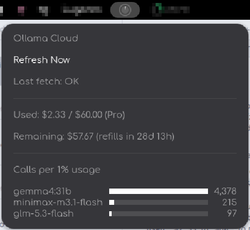
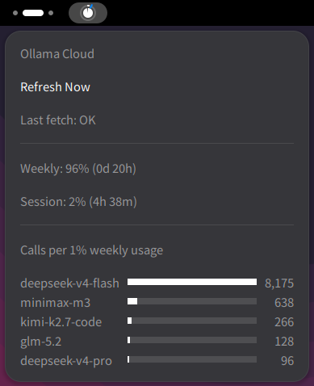

# Ollama Cloud 指示器

在 GNOME 顶栏显示 [Ollama Cloud](https://ollama.com) 使用量的扩展。支持多个账号、[月度额度套餐](https://ollama.com/blog/transparent-pricing)和旧版订阅，适用于 GNOME Shell 47–50。

## 使用量显示

**月度额度套餐**：内圆显示当月包含额度的消耗比例。弹出菜单显示已用额度、剩余额度、套餐名称，以及页面提供的下次补充时间。此类套餐不显示会话外环和指针。



**旧版订阅**：外环显示会话使用量，内圆显示周使用量，指针显示五小时会话窗口的进度。弹出菜单提供精确百分比和重置倒计时。



两种格式都提供按「每 1% 用量可调用次数」排序的模型图表。该图表来自 Ollama 提供的模型用量分布，不用于预测未来费用。

## 安装

安装 GNU Make、GLib 开发工具及 gettext 后，从源码安装：

```bash
make install
```

运行文件、编译后的设置结构和翻译将安装到 `${XDG_DATA_HOME:-$HOME/.local/share}/gnome-shell/extensions/ollama-usage@lanesun.anlbrain.com/`。

也可以构建并安装 ZIP：

```bash
./package.sh
gnome-extensions install --force ollama-usage.zip
```

Wayland 下注销并重新登录，然后启用扩展：

```bash
gnome-extensions enable ollama-usage@lanesun.anlbrain.com
```

生成的 `ollama-usage.zip` 也可上传至 GNOME Extensions。打包会重新编译翻译，包含全部运行模块和样式，排除凭据、测试、版本控制目录及编译后的 schema；GNOME 会在安装时编译 schema。

## 账号和 Cookie

1. 在浏览器中登录 [Ollama 设置页面](https://ollama.com/settings)。
2. 打开开发者工具，进入 **Application / Storage → Cookies → https://ollama.com**。
3. 复制 `__Secure-session` 的值。
4. 从仪表菜单打开**设置**，或运行：

   ```bash
   gnome-extensions prefs ollama-usage@lanesun.anlbrain.com
   ```

5. 将值粘贴到主账号的 `__Secure-session` 字段并点击应用按钮，扩展会立即获取数据。

需要同时显示其他账号时，点击**添加账号**，填写名称并应用该账号自己的 Cookie。可通过独立的浏览器配置或切换登录账号获取相应 Cookie。每个账号都有独立的仪表、刷新操作、缓存和错误状态；配置多个账号后，顶栏仪表旁会显示名称。其他账号可通过垃圾桶按钮移除。

升级时，原有 Cookie 继续用作主账号。**重置外观和刷新设置**不会删除账号名称及 Cookie。Cookie 输入框默认隐藏内容，其值保存在用户 GSettings 中，请妥善保管包含这些设置的备份。

## 外观和刷新

设置支持调整外环、内圆、指针的颜色及尺寸，修改顶栏位置和序号，并将刷新间隔设置为 5–3600 秒（默认 60 秒）。外观设置对所有账号生效。

每个账号单独请求 `https://ollama.com/settings`。网络或 HTTP 临时失败会以 1 / 2 / 4 秒间隔重试三次；卡住的请求会在 35 秒后取消。定时刷新不会打断正在进行的请求；身份验证重定向会停止请求并显示 Cookie 错误。

刷新失败后，上次成功的数据仍会保留，但仪表会变暗并明确标注为旧数据。修改 Cookie 会清除旧读数。空白或无法识别的页面不会被当成成功的 0% 用量；真实的 0% 用量可正常识别。

数据来自 Ollama 设置页面的 HTML，网站结构变化可能需要更新解析器。额度数值对应当月包含的额度池，不会根据该仪表推算额外购买的余额。

## 开发

项目不依赖 npm 包。运行测试需要 Node.js 22 或更新版本、GJS、libsoup 3、GLib 工具和 gettext。

```bash
make test
./package.sh
python3 tests/package.test.py
```

- `usage.js`：两种计费格式的解析及数据校验。
- `accounts.js`：账号记录和 Cookie 规范化。
- `client.js`：各账号的 HTTP 请求、缓存及重试生命周期。
- `extension.js`：顶栏绘制、菜单及账号协调。
- `prefs.js`：账号管理和外观设置。

测试使用合成 HTML 和本地 HTTP 服务，不使用真实凭据，也不请求 Ollama。GitHub Actions 会执行相同的解析、账号、请求生命周期和安装包检查。

## 许可证

MIT
