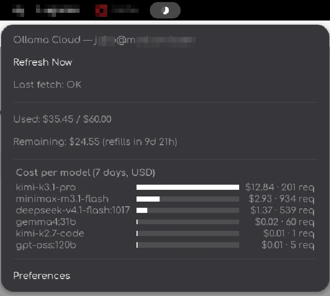

# Ollama Cloud 指示器

在 GNOME 顶栏显示 [Ollama Cloud](https://ollama.com) 使用量的扩展。支持多个账号、[月度额度套餐](https://ollama.com/blog/transparent-pricing)和旧版订阅，适用于 GNOME Shell 47–50。

## 使用量显示

**月度额度套餐**：内圆显示当月包含额度的消耗比例。弹出菜单显示已用额度、剩余额度、补充倒计时，以及单独购买的余额（如有）。此类套餐不显示会话外环和指针。



模型图表按七天内的费用列出每个模型的美元花费和请求次数，数据来自 Ollama 的用量 JSON，按费用排序。

**旧版订阅**：外环显示会话使用量，内圆显示周使用量，指针显示五小时会话窗口的进度。弹出菜单提供精确百分比和重置倒计时。

## 安装

安装 GNU Make、GLib 开发工具及 gettext 后，从源码安装：

```bash
make install
```

运行文件、编译后的设置结构和翻译将安装到 `${XDG_DATA_HOME:-$HOME/.local/share}/gnome-shell/extensions/ollama-usage@lanesun.anlbrain.com/`。

也可以构建并安装 ZIP：

```bash
./package.sh
gnome-extensions install --force ollama-usage.zip
```

Wayland 下注销并重新登录，然后启用扩展：

```bash
gnome-extensions enable ollama-usage@lanesun.anlbrain.com
```

生成的 `ollama-usage.zip` 也可上传至 GNOME Extensions。打包会重新编译翻译，包含全部运行模块和样式，排除凭据、测试、版本控制目录及编译后的 schema；GNOME 会在安装时编译 schema。

## 账号和 API 密钥

1. 在 [ollama.com/settings/keys](https://ollama.com/settings/keys) 创建 API 密钥。
2. 在指示器菜单中打开**偏好设置**，或运行：

   ```bash
   gnome-extensions prefs ollama-usage@lanesun.anlbrain.com
   ```

3. 将密钥粘贴到主账号的 **ollama.com API key** 输入框并点击应用，随即开始获取。应用空值会删除密钥。

也可在终端中保存：

```bash
nix shell nixpkgs#libsecret -c secret-tool store --label='ollama.com API key' account primary
```

密钥保存在系统密钥环（libsecret）中，不会写入 GSettings。需要显示其他账号时，点击**添加账号**，填写名称并应用该账号自己的密钥。每个账号都有独立的仪表、刷新操作、缓存和错误状态。其他账号可通过垃圾桶按钮移除。

## 外观和刷新

设置支持调整外环、内圆、指针的颜色及尺寸，修改顶栏位置和序号，并将刷新间隔设置为 5–3600 秒（默认 60 秒）。外观设置对所有账号生效。

每个账号单独请求 `https://ollama.com/api/balance` 和 `https://ollama.com/api/usage`（7 天，按模型分组）。Ollama 限制每位用户每分钟 10 次 API 请求，多设备共享。网络或 HTTP 临时失败会以 1 / 2 / 4 秒间隔重试三次；余额请求卡住时会在 35 秒后取消。按模型的明细为尽力而为，失败时其余数据仍会显示。定时刷新不会打断正在进行的请求；密钥被拒绝（401/403）时会停止请求并显示密钥错误。

刷新失败后，上次成功的数据仍会保留，但仪表会变暗并明确标注为旧数据。修改密钥会清除旧读数。无法识别的响应不会被当成成功的 0% 用量。

数据来自 Ollama 的 JSON API，扩展不再解析网站页面。包含额度与单独购买的余额分别显示，仅报告请求次数的旧版套餐也能正常显示。

## 开发

项目不依赖 npm 包。运行测试需要 Node.js 22 或更新版本、GJS、libsoup 3、GLib 工具和 gettext。

```bash
make test
./package.sh
python3 tests/package.test.py
```

- `usage.js`：仪表辅助（比例裁剪和空数据）；旧 HTML 解析器仅供旧测试使用。
- `accounts.js`：账号记录。
- `api.js`：Ollama 余额和用量 JSON 解析。
- `keyring.js`：在系统密钥环中保存 API 密钥。
- `client.js`：各账号的 HTTP 请求、缓存及重试生命周期。
- `extension.js`：顶栏绘制、菜单及账号协调。
- `prefs.js`：账号管理和外观设置。

测试使用合成的 JSON 和本地 HTTP 服务，不使用真实凭据，也不请求 Ollama。GitHub Actions 会执行相同的解析、账号、请求生命周期和安装包检查。

## 许可证

MIT
